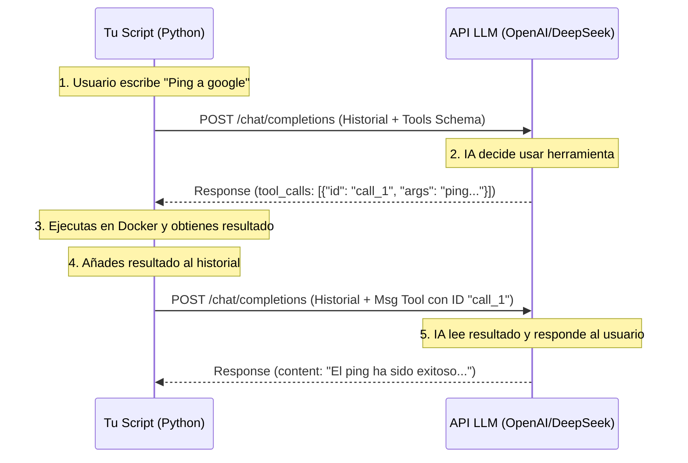

# 📘 Guía de Referencia: Estándar de APIs LLM (Formato OpenAI)

**Proyecto:** Agente Autónomo TFG  
**Estándar:** OpenAI Chat Completions API (`v1/chat/completions`)  
**Compatibilidad:** OpenAI, DeepSeek, OpenRouter, Ollama, LM Studio, Google Gemini (Adapter).

---

## 1. Concepto "Stateless" (Sin Memoria)
Las APIs de LLM **no recuerdan** nada. En cada petición, debes enviar **toda la conversación** desde el principio (historial) para que el modelo tenga contexto.

**Ecuación de la Petición:**
> `Respuesta = Modelo(Instrucciones + Historial + Mensaje Nuevo)`

---

## 2. Configuración del Cliente (Python)
Aunque usemos proveedores distintos, usamos la librería estándar `openai`. Solo cambiamos la `base_url` y la `api_key`.

```python
from openai import OpenAI

# OPCIÓN A: OpenAI Oficial
client = OpenAI(api_key="sk-...")

# OPCIÓN B: DeepSeek
client = OpenAI(
    base_url="[https://api.deepseek.com](https://api.deepseek.com)", 
    api_key="sk-..."
)

# OPCIÓN C: Ollama (Local)
client = OpenAI(
    base_url="http://localhost:11434/v1",
    api_key="ollama" # Cualquiera vale
)

# OPCIÓN D: OpenRouter
client = OpenAI(
    base_url="[https://openrouter.ai/api/v1](https://openrouter.ai/api/v1)",
    api_key="sk-or-..."
)
```
-----

## 3\. Estructura de Mensajes (Roles)

El historial (`messages`) es una **Lista de Diccionarios**. Cada diccionario representa un turno.

| Rol | Descripción | Ejemplo de Uso |
| :--- | :--- | :--- |
| **`system`** | **Dios/Reglas.** Define la personalidad y límites. Invisible al usuario. | "Eres un experto en Ciberseguridad. Usa JSON." |
| **`user`** | **Humano.** La entrada del usuario. | "Escanea la IP 10.5.0.4" |
| **`assistant`** | **IA.** Respuestas previas del modelo. | "Entendido, iniciando escaneo con Nmap..." |
| **`tool`** | **Resultado.** Salida de la ejecución de un comando (Docker). | `{"stdout": "Port 80 OPEN", "code": 0}` |

-----

## 4\. La Petición Principal (`POST`)

Esta es la llamada que harás el 99% del tiempo.

```python
response = client.chat.completions.create(
    model="gpt-4o",           # Identificador del modelo
    messages=historial_chat,  # Lista completa de mensajes
    temperature=0.1,          # Creatividad (0.0 = Robótico/Preciso, 1.0 = Creativo)
    tools=tools_schema,       # Definición de herramientas (Opcional)
    tool_choice="auto"        # "auto" (la IA decide) o "none" (solo habla)
)
```

-----

## 5\. Herramientas (Tool Calling)

Esta es la parte crítica para el Agente. Se divide en **Definición** (Ida) y **Resultado** (Vuelta).

### A. Definición (Schema) - Lo que envías en `tools=`

Solo defines los **Inputs** (Argumentos) que tu función necesita.

```python
tools_schema = [
  {
    "type": "function",
    "function": {
      "name": "ejecutar_comando",
      "description": "Ejecuta un comando en el terminal Linux del Agente.",
      "parameters": {
        "type": "object",
        "properties": {
          "command": {
            "type": "string", 
            "description": "Comando bash. Ej: 'ls -la'"
          },
          "timeout": {
             "type": "integer",
             "description": "Tiempo maximo en segundos"
          }
        },
        "required": ["command"]
      }
    }
  }
]
```

### B. Detección (Respuesta de la IA)

Si la IA quiere usar una herramienta, **NO** devuelve texto en `content`. Devuelve `tool_calls`.

**Respuesta recibida (`response.choices[0].message`):**

```json
{
  "role": "assistant",
  "content": null, 
  "tool_calls": [
    {
      "id": "call_abc123",  // <--- LA IA NO LO GENERA, LO ASIGNAMOS EN EL SCRIPT
      "type": "function",
      "function": {
        "name": "ejecutar_comando",
        "arguments": "{\"command\": \"nmap -sV target\"}" // <--- Argumentos generados
      }
    }
  ]
}
```

### C. Cierre del Bucle (Respuesta `tool`)

Una vez ejecutas el comando en Docker, debes responder a la IA para que sepa qué pasó.

**Tu mensaje de respuesta (Python):**

```python
{
  "role": "tool",
  "tool_call_id": "call_abc123", // <--- Pegas el ID que te dio la IA
  "name": "ejecutar_comando",
  "content": json.dumps({        // <--- El resultado (libre formato, texto o JSON)
      "exit_code": 0,
      "stdout": "Nmap done: 1 IP address (1 host up)..."
  })
}
```

-----

## 6\. Cheat Sheet de Parámetros Críticos

| Parámetro | Valor Recomendado (TFG) | Efecto |
| :--- | :--- | :--- |
| **`temperature`** | `0.0` - `0.2` | Queremos precisión técnica y JSONs válidos. Evita alucinaciones. |
| **`stream`** | `False` (al principio) | Recibe la respuesta entera de golpe. Más fácil de depurar. |
| **`max_tokens`** | `4096` | Límite de respuesta. Aumentar si el reporte es muy largo. |
| **`top_p`** | `1.0` | Déjalo por defecto si usas temperatura baja. |

-----

## 7\. Diagrama de Flujo de Datos


